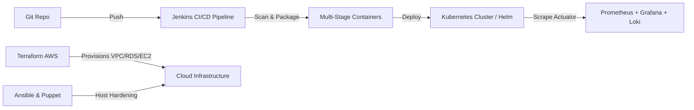

# VehicleSphere — Cloud-Native Wedding & Event Vehicle Rental Platform

> **Final-Year B.Tech Computer Science Capstone Project & DevOps Lifecycle**  
> **Student:** Tejasvi, B.Tech CSE, Lovely Professional University  
> **Contact:** [tejasvijain09@gmail.com](mailto:tejasvijain09@gmail.com) | +91 98154 08330  
> A full-stack Indian wedding & special-event vehicle rental platform built with Java 21, Spring Boot 3, React 18, Tailwind CSS, PostgreSQL 17, Docker, Jenkins CI/CD, AWS Terraform IaC, Ansible, Puppet, Kubernetes, Helm, Prometheus, Grafana, Loki, Alertmanager, Razorpay Test Gateway, and OpenPDF.

---

## 🚀 Live Demo Quick Reference

- **Frontend Application (Dev):** [http://localhost:5173](http://localhost:5173)
- **Edge Reverse Proxy (Docker):** [http://localhost](http://localhost)
- **Admin Portal (Auto-Redirects):** [http://localhost:5173/admin](http://localhost:5173/admin) ➔ `/admin/dashboard`
- **Backend REST API:** [http://localhost:8080](http://localhost:8080)
- **Interactive Swagger UI:** [http://localhost:8080/swagger-ui/index.html](http://localhost:8080/swagger-ui/index.html)
- **Spring Boot Actuator Health:** [http://localhost:8080/actuator/health](http://localhost:8080/actuator/health)
- **Prometheus Metrics Endpoint:** [http://localhost:8080/actuator/prometheus](http://localhost:8080/actuator/prometheus)
- **Grafana Observability Dashboard:** [http://localhost:3000](http://localhost:3000) (`admin` / `admin`)
- **Prometheus TSDB:** [http://localhost:9090](http://localhost:9090)
- **Alertmanager:** [http://localhost:9093](http://localhost:9093)

### 🔑 Demo Login Credentials

The application automatically seeds realistic demo data on initial startup. For your college viva demonstration, one-click quick-fill buttons are provided directly on the login form:

| Role | Email | Password | Name | Contact | Access Capabilities |
|---|---|---|---|---|---|
| **ADMIN** | `admin@vehiclesphere.com` | `Admin@123` | Platform Administrator | `+91 98154 08330` | Full dashboard KPIs, revenue analytics, fleet CRUD, vehicle image uploads, booking approval/rejection workflows, customer directory |
| **CUSTOMER** | `gurpreet.singh@example.com` | `Customer@123` | Gurpreet Singh | `+91 98765 43210` | Vehicle browsing, live price calculation, Razorpay payment, wishlist curation, completed trip reviews, PDF invoice download |
| **CUSTOMER** | `simran.kaur@example.com` | `Customer@123` | Simran Kaur | `+91 98765 43211` | Customer account with existing sample reservations |
| **CUSTOMER** | `harleen.kaur@example.com` | `Customer@123` | Harleen Kaur | `+91 98155 44321` | Customer account with Indian phone number & Punjabi identity |

---

## 🏗️ DevOps & Cloud-Native Engineering

VehicleSphere implements a complete, production-grade DevOps lifecycle covering infrastructure automation, continuous integration, zero-downtime orchestration, and continuous monitoring:



### 1. 🐳 Containerization (`docker-compose.yml`)
- Multi-stage `backend/Dockerfile` with non-root security user (`vehiclesphere`), JVM container memory optimization (`-XX:+UseContainerSupport -XX:MaxRAMPercentage=75.0`), and built-in Actuator healthcheck.
- Multi-stage `frontend/Dockerfile` leveraging Node 22 build caching and an Nginx 1.27 Alpine runtime with client-side SPA routing fallbacks.
- Edge `nginx/Dockerfile` providing rate-limiting, CORS handling, client payload limits, and unified reverse proxy routing.
- Composable stack in `docker-compose.yml` linking PostgreSQL 17, Backend, Frontend, and Nginx.

### 2. 🔄 Enterprise Jenkins CI/CD (`Jenkinsfile`)
- Declarative 8-stage pipeline with automated checkout, environment validation, backend Maven test reporting with JUnit archives, frontend Vite production compilation, executable JAR packaging, multi-image Docker builds, container vulnerability scanning with **Trivy**, registry push, and automated staging smoke testing.

### 3. ☁️ AWS Infrastructure as Code (`terraform/`)
- Complete Terraform module provisioning a custom Multi-AZ VPC (`10.0.0.0/16`) in `ap-south-1` with public/private subnet tiers, route tables, and Internet Gateway.
- Defense-in-depth Security Groups isolating ALB, EC2 compute, and RDS PostgreSQL 16.
- Secure credential management using AWS Secrets Manager to generate and inject database master secrets.
- Encrypted AWS S3 bucket with KMS encryption for invoice archives and vehicle images.
- Automated `cloud-init` user-data script bootstrapping Docker and host prerequisites on Ubuntu 24.04 LTS.

### 4. ⚙️ Configuration Management (`ansible/` & `puppet/`)
- Modular **Ansible** playbooks and roles (`docker`, `app`) automating host provisioning, package installation, environment variable templating (`env.j2`), and health probes.
- **Puppet** declarative manifest (`puppet/manifests/site.pp`) enforcing baseline system packages, user groups, firewall rules, and container service states.

### 5. ☸️ Kubernetes & Helm Orchestration (`k8s/` & `helm/`)
- Production Kubernetes manifests in `k8s/` with dedicated namespace, configmaps, secrets, persistent volume claims, rolling update deployments, liveness/readiness probes, and an Nginx Ingress Controller.
- **Horizontal Pod Autoscaling (HPA)** configured for the Spring Boot backend, automatically scaling from 2 to 6 replicas based on CPU (75%) and Memory (80%) thresholds.
- Reusable, production-grade **Helm Chart** (`helm/vehiclesphere/`) validated with `helm lint` and parameterized via `values.yaml`.

### 6. 📊 Full Observability & Monitoring (`monitoring/`)
- **Prometheus TSDB:** Scrapes Spring Boot Micrometer metrics (`/actuator/prometheus`), cAdvisor, and Node Exporter.
- **Prometheus Alerting Rules:** Out-of-the-box alerts for service downtime (`VehicleSphereBackendDown`), high 5xx error rates (>5%), p95 latency spikes (>1.5s), JVM heap memory exhaustion (>85%), and HikariCP connection starvation.
- **Alertmanager:** Deduplicates and routes critical and warning alerts with webhook receivers.
- **Grafana Observability Dashboard:** Pre-provisioned dashboards visualizing active requests, response latency, JVM heap/non-heap memory, CPU usage, and HikariCP database connection pool metrics.
- **Loki & Promtail:** Centralized log aggregation capturing container stdout/stderr logs and correlating them in Grafana.

---

## 🌟 Advanced Business Features Overview

### 1. 💳 Razorpay Payment Gateway (Test Mode)
- **Backend Order Creation:** Securely calculates payable amounts in paise on the backend (`totalAmount * 100`) and generates orders using the Razorpay Java SDK.
- **HMAC-SHA256 Signature Verification:** Verifies payment authenticity via cryptographic signature checks before marking records as `PAID`. Never trusts untrusted frontend reports.
- **Duplicate Payment Prevention:** Rejects duplicate payment attempts for already settled bookings.
- **Built-in Test Mode Simulation:** Seamlessly operates in test mode even when external keys are unconfigured, allowing examiners to test both payment success and cancellation/failure simulations.
- **Razorpay Standard Test Cards:**
  - Card Number: `4012 0000 0000 0002`
  - Expiry: Any future date (e.g. `12/28`)
  - CVV: `123`
  - OTP: `123456`
- **Payment History:** Complete customer transaction ledger displaying Order IDs, Payment IDs, timestamps, and status badges.

### 2. 📄 Downloadable PDF GST Rental Tax Invoice
- **Automated OpenPDF Engine:** Dynamically generates GST-compliant vehicle rental tax invoices.
- **Indian GST Breakdown:** Includes Company GSTIN (`03AAAAA0000A1Z5`), SAC Code (`996601`), Taxable Subtotal, CGST (9.0%), SGST (9.0%), Total GST (18.0%), and Grand Total.
- **Branded & Secured:** Includes VehicleSphere branding, customer details, booking reference, rental dates, daily rates, calculated totals, and transaction references.
- **Access Control:** Customers can only download invoices for their own reservations; administrators can download for any reservation.

### 3. ⭐ Customer Reviews & Ratings System
- **Verified Trip Reviews:** Only customers who have completed their vehicle rentals (`COMPLETED` status) can submit reviews.
- **Interactive Ratings:** 1 to 5 star rating with customer commentary.
- **Duplicate Prevention:** Enforces a unique constraint preventing multiple reviews per booking.
- **Fleet Showcase:** Displays dynamic star rating summaries, average ratings, and customer feedback on vehicle detail pages.

### 4. 📊 Advanced Admin Dashboard & Analytics
- **Reconciled Revenue:** Total revenue metric strictly aggregates successfully paid bookings (`payment_status = 'PAID'`).
- **Dynamic Trend Charts:** Responsive monthly revenue and booking volume charts over time.
- **Status Distribution:** Visual breakdown of platform reservations (Pending, Confirmed, Active, Completed, Cancelled).
- **Top 5 Rented Vehicles:** Leaderboard ranking fleet vehicles by rental frequency.

### 5. 🖼️ Vehicle Image Management & Live Preview
- **Real-Time Preview:** Add/Edit vehicle modal features an instant live image preview box.
- **Validated Multipart File Upload:** Admins can directly upload vehicle images (JPEG, PNG, WebP up to 5MB) stored safely outside the database.

### 6. ❤️ Customer Wishlist (Saved Vehicles)
- **Persisted in PostgreSQL:** Wishlists are stored in the database with unique constraints.
- **One-Click Heart Toggle:** Heart button on vehicle cards and detail pages for quick saving.
- **Dedicated Wishlist View:** Customers have a dedicated `/wishlist` page to curate and compare their celebration choices.

### 7. 📧 Asynchronous Email Notifications
- **Spring Boot Mail Integration:** Background async worker (`@Async`) sends branded HTML notifications for registration, booking requests, confirmations, cancellations, and payment receipts.
- **Development Fallback Mode:** When SMTP credentials are not configured (`app.mail.enabled=false`), all email events are logged cleanly to the console without interrupting requests.

---

## 🚗 Wedding & Celebration Fleet Overview

VehicleSphere offers an exclusive luxury celebration fleet across major North Indian wedding destinations (Chandigarh, Delhi NCR, Ludhiana, Amritsar, Jalandhar, Jaipur, and Mumbai):

| Vehicle | Category | Daily Rate | Registration | Key Wedding Use Case |
|---|---|---|---|---|
| **Rolls-Royce Phantom VIII** | Luxury | ₹ 95,000 / day | `DL-01-RR-0007` | Royal wedding groom entry & starlight ceiling luxury |
| **Rolls-Royce Ghost Series II** | Luxury | ₹ 65,000 / day | `CH-01-RR-0001` | Crown jewel bridal send-off (Doli) & VIP arrivals |
| **Mercedes-Benz G63 AMG (G-Wagon)** | Luxury | ₹ 55,000 / day | `CH-01-GW-0063` | Thunderous V8 twin-turbo Baraat arrival showstopper |
| **Range Rover Autobiography LWB** | SUV | ₹ 45,000 / day | `CH-01-RR-1111` | Executive class comfort-plus rear lounge & convoy VIPs |
| **Toyota Land Cruiser 300 (LC300)** | SUV | ₹ 35,000 / day | `PB-10-LC-0009` | High-prestige twin-turbo V6 Baraat convoy leader |
| **Porsche Taycan 4S Luxury EV** | Electric | ₹ 30,000 / day | `DL-01-EV-9110` | Silent futuristic reception entry & cinematic video reels |
| **Mercedes-Benz S-Class S450 Maybach** | Luxury | ₹ 28,000 / day | `PB-10-LU-3001` | Executive bridal Doli send-off with Burmester 4D sound |
| **Land Rover Defender 110 X-Dynamic** | SUV | ₹ 25,000 / day | `PB-65-DF-0001` | The viral sensation of Punjabi Baraat escort convoys |
| **BMW 7 Series 740Li M Sport** | Sedan | ₹ 25,000 / day | `CH-01-WD-5510` | 31.3-inch 8K Theatre Screen & sky lounge couple arrival |
| **Audi A8L Quattro Matrix** | Sedan | ₹ 22,000 / day | `RJ-14-JP-6002` | Royal palace weddings in Rajasthan & VIP hospitality |
| **Mini Cooper S Convertible (Open-Top)** | Hatchback | ₹ 18,000 / day | `CH-01-MC-3321` | Open-roof floral shower entry & pre-wedding shoots |
| **Mercedes-Benz E-Class LWB E350d** | Sedan | ₹ 16,000 / day | `PB-10-MB-3500` | Reclining rear lounge seats for VIP elders and family |
| **Toyota Fortuner Legender 4x4** | SUV | ₹ 8,500 / day | `PB-02-AM-4491` | Heavy Baraat convoy muscle & celebration escort fleet |
| **Mahindra Scorpio-N Z8L 4x4** | SUV | ₹ 7,000 / day | `PB-08-SN-0008` | 'Big Daddy of SUVs' with Sony 3D sound for Baraat band |

---

## 🛠️ Technology Stack

### Backend
- **Language:** Java 21 (LTS)
- **Framework:** Spring Boot 3.3.4
- **Web:** Spring Web (RESTful API at `/api/v1`)
- **Persistence:** Spring Data JPA, Hibernate ORM
- **Security:** Spring Security 6, Stateless JWT (JSON Web Tokens), BCrypt password hashing
- **Payments:** Razorpay Java SDK 1.4.6
- **PDF Generation:** OpenPDF 1.3.39
- **Metrics & Observability:** Spring Boot Actuator, Micrometer Prometheus Registry
- **Email:** Spring Boot Starter Mail with asynchronous background dispatching (`@Async`)
- **Validation:** Jakarta Bean Validation (Hibernate Validator)
- **Database Migrations:** Flyway 10 (`V1__init_schema.sql`, `V2__advanced_features.sql`)
- **API Documentation:** Springdoc OpenAPI 2.6.0 with Swagger UI
- **Build Tool:** Apache Maven 3.9+

### Frontend
- **Library:** React 18
- **Bundler / Tooling:** Vite 5
- **Styling:** Tailwind CSS 3
- **Routing:** React Router v6
- **HTTP Client:** Axios with JWT request & response interceptors
- **Payment UI:** Razorpay Checkout JS integration with fallback test simulator
- **Icons:** Lucide React

### Database
- **Engine:** PostgreSQL 17 / 16
- **Migrations:** Flyway version-controlled migrations

### DevOps, Cloud & Observability
- **Containers:** Docker, Multi-Stage Dockerfiles, Docker Compose v2
- **CI/CD:** Jenkins Declarative Pipeline, Trivy Container Security Scanner
- **Infrastructure as Code:** HashiCorp Terraform (AWS VPC, Subnets, Security Groups, RDS, Secrets Manager, EC2, S3)
- **Configuration Management:** Ansible Playbooks, Puppet Manifests
- **Orchestration:** Kubernetes 1.30+ Manifests, Horizontal Pod Autoscaler (HPA), Helm 3 Chart
- **Observability:** Prometheus, Grafana, Loki, Alertmanager, Promtail, Node Exporter

---

## 🏃 Quick Start Guide

### 1. Run Everything with Docker Compose (Recommended)
```bash
# 1. Clone repository & configure environment variables
git clone https://github.com/tejasvijain09/VehicleSphere.git
cd VehicleSphere
cp .env.example .env

# 2. Start Application Stack (PostgreSQL, Backend, Frontend, Nginx Reverse Proxy)
docker compose up -d --build

# 3. Access Web Application:
# http://localhost (via Nginx Edge Proxy) or http://localhost:5173
```

### 2. Start Observability & Monitoring Stack
```bash
# Layer Prometheus, Grafana, Alertmanager, Loki, Promtail onto the stack:
docker compose -f docker-compose.yml -f monitoring/docker-compose.monitoring.yml up -d

# Open Grafana: http://localhost:3000 (Credentials: admin / admin)
# Open Prometheus: http://localhost:9090
```

### 3. Deploy to Kubernetes with Helm
```bash
# Validate chart
helm lint helm/vehiclesphere

# Deploy to cluster
helm install vehiclesphere helm/vehiclesphere --namespace vehiclesphere --create-namespace
```

### 4. Running Backend & Frontend for Local Development
```bash
# Backend (Java 21):
cd backend
mvn clean spring-boot:run

# Frontend (Node 18+):
cd frontend
npm install
npm run dev
```

---

## 📋 Viva Demonstration Walkthrough

1. **Verify Cloud Health & Metrics:**
   - Open [http://localhost:8080/actuator/health](http://localhost:8080/actuator/health) showing `UP` status with liveness, readiness, and PostgreSQL DB probes.
   - Open [http://localhost:8080/actuator/prometheus](http://localhost:8080/actuator/prometheus) showing real-time Micrometer JVM & HTTP metrics.
   - Open Grafana at [http://localhost:3000](http://localhost:3000) to demonstrate active request rates, p95 latency, and HikariCP connection pool health.
2. **Customer Booking & Razorpay Payment:**
   - Log in as Customer `gurpreet.singh@example.com` (password: `Customer@123`).
   - Browse fleet, select a vehicle (e.g. *Rolls-Royce Phantom VIII* or *Mercedes S-Class*), and reserve celebration dates.
   - Go to **My Bookings**, notice the **UNPAID** badge, and click **Pay with Razorpay**.
   - Complete authorization in the modal ➔ Booking status automatically transitions to **CONFIRMED** and payment status becomes **PAID**.
3. **Download GST Tax Invoice:**
   - In **My Bookings**, click **Tax Invoice** on any confirmed/completed booking.
   - Observe the instantly downloaded branded PDF containing customer details, invoice numbers, breakdown, and payment transaction reference.
4. **Wishlist Management:**
   - Click the heart icon on any vehicle card to save it.
   - Navigate to **Wishlist** from the top bar to inspect your saved celebration collection.
5. **Customer Review Submission:**
   - On completed booking records, click **Review Vehicle**.
   - Submit a 5-star rating with personal feedback.
   - Visit the vehicle's details page to observe the newly updated average rating and customer review card.
6. **Admin Analytics & Management:**
   - Log in as Admin `admin@vehiclesphere.com` (password: `Admin@123`).
   - Inspect the **Admin Dashboard** showing paid revenue (strictly aggregated from successful payments), monthly revenue trends, status distribution, and top rented vehicles.
   - Navigate to **Vehicles**, click **Add Vehicle** or **Edit**, and test the **Live Photo Preview** and **Upload Image** features.
7. **Interactive API Documentation:**
   - Open [http://localhost:8080/swagger-ui/index.html](http://localhost:8080/swagger-ui/index.html) to demonstrate all 25+ secured endpoints and interactive documentation.
