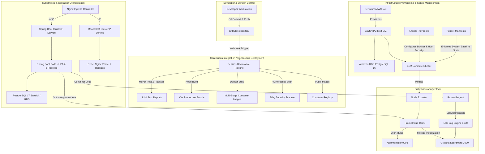

# VehicleSphere — Enterprise DevOps & Cloud-Native Architecture

> **Comprehensive Technical Guide for Final-Year B.Tech Capstone Examination**  
> **Student:** Tejasvi, B.Tech Computer Science & Engineering, Lovely Professional University  
> **Application:** VehicleSphere — Indian Wedding & Event Vehicle Rental Platform  
> **Stack:** Java 21 / Spring Boot 3.3.4, React 18 / Vite 5, PostgreSQL 17, Docker, Jenkins, Terraform, Ansible, Puppet, Kubernetes, Helm, Prometheus, Grafana, Loki, Alertmanager

---

## 1. High-Level DevOps & System Architecture



---

## 2. Component Specifications

### 2.1 Multi-Stage Containerization

| Image | Build Stage | Runtime Stage | Key Optimizations |
|---|---|---|---|
| **`backend`** | `maven:3.9.9-eclipse-temurin-21-alpine` | `eclipse-temurin:21-jre-alpine` | Non-root `vehiclesphere` user (`UID 10001`), JVM cgroup memory flags (`-XX:+UseContainerSupport -XX:MaxRAMPercentage=75.0`), Actuator `/actuator/health` healthcheck probe. Size ~280MB vs 900MB raw. |
| **`frontend`** | `node:22-alpine` | `nginx:1.27-alpine` | Multi-stage static compilation with Vite, custom Nginx SPA routing fallback (`try_files $uri $uri/ /index.html`), gzip compression, security headers. Size ~25MB. |
| **`nginx` (Edge)** | Alpine Linux | `nginx:1.27-alpine` | Client payload limits (`20M`), reverse proxy timeouts, rate limiting zone (`10r/s`), microsecond upstream logging, centralized TLS termination. |

### 2.2 Jenkins CI/CD Pipeline (`Jenkinsfile`)

The enterprise declarative pipeline automates the entire software delivery lifecycle across 8 distinct stages:

1. **Stage 1: Checkout & Verification:** Clones repository, prints environment metadata, and validates toolchains (Java 21, Maven 3.9, Node 22, Docker, Trivy).
2. **Stage 2: Backend Unit & Integration Tests:** Executes `mvn clean test` with surefire test reporting and publishes JUnit test results into Jenkins.
3. **Stage 3: Frontend Build & Lint:** Executes `npm ci` and `npm run build`, producing an optimized production bundle in `dist/`.
4. **Stage 4: Package Backend Artifact:** Builds the production executable jar (`mvn package -DskipTests`) and archives it.
5. **Stage 5: Multi-Container Docker Build:** Builds `backend:1.0.0`, `frontend:1.0.0`, and `nginx:1.0.0` with Git SHA and build tags.
6. **Stage 6: Container Security Vulnerability Scan:** Invokes **Trivy** to scan all built images for HIGH and CRITICAL CVE vulnerabilities, outputting SARIF/table reports.
7. **Stage 7: Container Registry Push:** Authenticates securely with Docker Hub credentials and pushes tagged production images.
8. **Stage 8: Automated Staging Deployment:** Executes zero-downtime deployment using Docker Compose / Kubernetes and runs automated health check probes against `/actuator/health`.

### 2.3 Infrastructure as Code (AWS Terraform)

Located in `terraform/`:
- **VPC & Networking:** Custom VPC (`10.0.0.0/16`) spanning 2 Availability Zones (`ap-south-1a`, `ap-south-1b`) with public subnets for edge/compute and private subnets for isolated database storage.
- **Security Groups:** Defense-in-depth security groups:
  - `alb-sg`: Allows HTTP 80 and HTTPS 443 from public internet (`0.0.0.0/0`).
  - `ec2-sg`: Allows ports 80, 443, and 8080 from ALB; SSH 22 strictly from authorized IP range.
  - `rds-sg`: Port 5432 strictly allowed from `ec2-sg` (database is physically inaccessible from public internet).
- **Amazon RDS PostgreSQL 16:** Multi-AZ capable database instance with automated storage autoscaling (20GB to 100GB), encrypted storage at rest (KMS), and automated backups (7-day retention).
- **AWS Secrets Manager:** Automatically generates, manages, and injects 32-character master database passwords without exposing them in Terraform state or Git.
- **EC2 Compute Cluster:** Ubuntu 24.04 LTS instance provisioned with automated `cloud-init` user-data script installing Docker, Docker Compose, AWS CLI, and setting up system limits.
- **S3 Bucket:** Private encrypted S3 bucket (`aws:kms`) with versioning enabled for storing vehicle uploads and PDF invoice backups.

### 2.4 Configuration Management (Ansible & Puppet)

- **Ansible (`ansible/`):**
  - Modular roles: `docker` (installs engine, containerd, compose plugin, enables services) and `app` (deploys app environment variables, Docker Compose definition, restarts stack, executes readiness probes).
  - Jinja2 templating: `ansible/roles/app/templates/env.j2` securely maps vault secrets to runtime `.env`.
- **Puppet (`puppet/manifests/site.pp`):**
  - Enforces baseline host security, package dependencies, firewall policies, non-root system users, and directory permissions.

### 2.5 Container Orchestration (Kubernetes & Helm)

- **Kubernetes Manifests (`k8s/`):**
  - `namespace.yaml`: Dedicated `vehiclesphere` namespace.
  - `configmap.yaml` & `secrets.yaml`: Declarative environment variables and base64 encoded secrets.
  - `postgres.yaml`: PersistentVolumeClaim (10Gi), single-replica Deployment, and ClusterIP Service.
  - `backend.yaml`: RollingUpdate Deployment (2 replicas), resource requests/limits (`300m/512Mi` to `1000m/1Gi`), liveness probe (`/actuator/health/liveness`), readiness probe (`/actuator/health/readiness`), ClusterIP Service on 8080, and **HorizontalPodAutoscaler (HPA)** scaling from 2 to 6 replicas based on CPU (75%) and Memory (80%).
  - `frontend.yaml`: 2-replica Deployment with rolling update, HTTP `/healthz` probes, and ClusterIP Service on port 80.
  - `ingress.yaml`: Nginx Ingress routing `/api/`, `/actuator/`, `/swagger-ui`, and `/` traffic with proxy buffering and timeout configurations.
- **Helm Chart (`helm/vehiclesphere/`):**
  - Fully parameterized package with `Chart.yaml`, `values.yaml`, and modular templates (`_helpers.tpl`, `backend.yaml`, `frontend.yaml`, `postgres.yaml`, `ingress.yaml`, `configmap.yaml`, `secrets.yaml`).
  - Validated with `helm lint` and tested with `helm template`.

### 2.6 Full Observability Stack (Prometheus, Grafana, Loki, Alertmanager)

Located in `monitoring/`:
- **Prometheus (`monitoring/prometheus/`):**
  - Scrapes Spring Boot backend `/actuator/prometheus` (Micrometer metrics) every 10 seconds.
  - Scrapes Node Exporter (host CPU, memory, disk, network) every 15 seconds.
  - Scrapes cAdvisor (container resource utilization) every 15 seconds.
- **Prometheus Alerting Rules (`monitoring/prometheus/alert_rules.yml`):**
  - `VehicleSphereBackendDown`: Triggers critical alert if backend is unreachable for > 1 minute.
  - `VehicleSphereHigh5xxErrorRate`: Triggers critical alert if 5xx HTTP responses exceed 5% over 5 minutes.
  - `VehicleSphereHighResponseLatency`: Triggers warning alert if p95 response time exceeds 1.5 seconds over 5 minutes.
  - `VehicleSphereHighJvmMemoryUsage`: Triggers warning if JVM heap usage exceeds 85% for 3 minutes.
  - `VehicleSphereHikariPoolExhaustion`: Triggers critical alert if pending DB connections exceed 5.
  - `HostHighCpuLoad` & `HostLowDiskSpace`: Host-level infrastructure alerts.
- **Alertmanager (`monitoring/alertmanager/alertmanager.yml`):**
  - Routes alerts by severity with automatic deduplication and webhook receivers.
- **Grafana (`monitoring/grafana/`):**
  - Pre-provisioned Prometheus and Loki datasources.
  - Pre-loaded **VehicleSphere Overview Dashboard** (`monitoring/grafana/dashboards/vehiclesphere-overview.json`):
    - Service Status & Uptime Gauge
    - Total HTTP Request Rate (req/s)
    - p95 API Latency Gauge
    - JVM Heap & Non-Heap Memory Breakdown
    - HTTP Requests by Status Code (2xx, 4xx, 5xx)
    - HikariCP Connection Pool (Active, Idle, Pending)
    - Process vs System CPU Usage
- **Loki & Promtail (`monitoring/loki/` & `monitoring/promtail/`):**
  - Lightweight centralized log aggregation collecting logs from all Docker containers and streaming them directly into Grafana for real-time log querying and correlation.

---

## 3. Quick Run Commands

### 3.1 Local Docker Compose (Full Application Stack)
```bash
# 1. Copy sample environment variables
cp .env.example .env

# 2. Build and start containers in background
docker compose up -d --build

# 3. Check health and status
docker compose ps

# 4. Access application
# Frontend / Reverse Proxy: http://localhost:80
# Backend direct: http://localhost:8080
# Swagger UI: http://localhost:8080/swagger-ui/index.html
# Actuator Health: http://localhost:8080/actuator/health
```

### 3.2 Launch Observability Stack
```bash
# Start Prometheus, Grafana, Alertmanager, Loki, Promtail, and Node Exporter
docker compose -f docker-compose.yml -f monitoring/docker-compose.monitoring.yml up -d

# Access Monitoring Portals:
# - Grafana:      http://localhost:3000  (admin / admin)
# - Prometheus:   http://localhost:9090
# - Alertmanager: http://localhost:9093
# - Loki:         http://localhost:3100
```

### 3.3 Kubernetes Deployment via Helm
```bash
# 1. Verify Helm Chart syntax
helm lint helm/vehiclesphere

# 2. Dry-run render templates
helm template vehiclesphere helm/vehiclesphere

# 3. Install on Kubernetes Cluster
helm install vehiclesphere helm/vehiclesphere --namespace vehiclesphere --create-namespace

# 4. Inspect running pods and HPA
kubectl get pods,svc,hpa -n vehiclesphere
```

### 3.4 Infrastructure as Code via Terraform
```bash
cd terraform
cp terraform.tfvars.example terraform.tfvars
terraform init
terraform plan
# terraform apply
```
